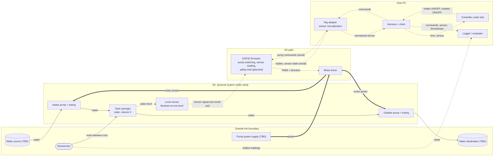
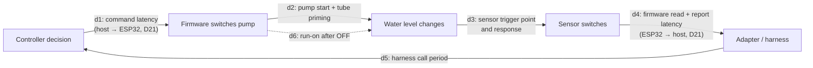
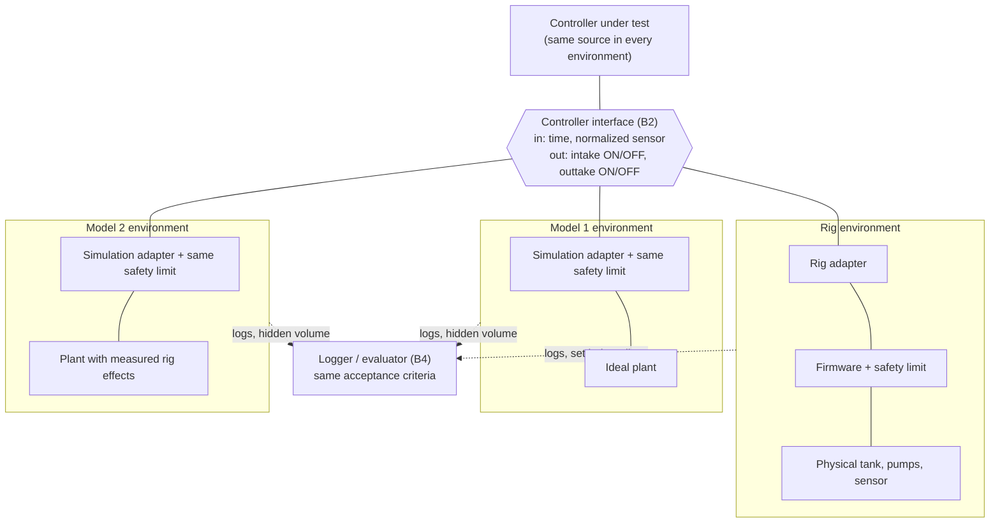

# Conceptual model (WP02)

> **Status: Approved by researcher 2026-11-25 (agent-completed by Claude Code).** Built on `design/physical_system.md` (WP01, same session per D28). Describes entities, water transfer, information exchange and boundaries independently of any implementation: no equations (WP05), classes (WP07) or controller behaviour (WP06). Component IDs (C1–C13) and unknowns (U01–U31) refer to WP01.

## 1. Labels

| Label | Meaning |
|---|---|
| **Actual** | Exists on the rig today |
| **Planned** | Required by an approved decision, not yet built |
| **Conceptual** | An abstraction used by the models; not a separate physical thing |

## 2. Entities

| Entity | Physical counterpart | Label | Conceptual role |
|---|---|---|---|
| Tank | Syringe (C1) | Actual | Holds water; its volume is the central state |
| Intake | Intake pump with tubing (C2, C4) | Actual | Transfers water from the source into the tank while ON |
| Outtake | Outtake pump with tubing (C3, C4) | Actual | Transfers water from the tank to the destination while ON |
| Source, destination | Containers (C5, C6) | Actual (details TBD) | Unlimited supply and sink outside the boundary |
| Level sensor | C7 | Actual (not wired) | Reports one Boolean: water at or above its level, or not |
| Safety limit | Firmware maximum ON time (D27) | Planned | Switches a pump OFF after a fixed time regardless of commands |
| I/O path | Motor driver, ESP32 firmware, serial link (C8–C11) | Actual (sensor reporting planned) | Carries commands to the pumps and sensor state to the host; adds delay |
| Controller | Python program on the host (D21, D29) | Planned | Receives time and normalized sensor; decides intake and outtake ON/OFF |
| Harness | Host software calling the controller and holding the clock | Planned | Calls the controller periodically; can override the sensor input for fault scenarios (D29) |
| Logger / evaluator | Host software | Planned | Records commands, sensor and time; in simulation also the hidden volume; judges acceptance criteria |
| Researcher | — | Actual | Reads settled volumes, resets the tank, approves runs |
| Safe-limit mark | Mark on the syringe (C13) | Planned | Visual maximum below capacity used as the rig's overflow criterion (D24) |

## 3. Diagram: water, energy and information

Solid arrows: water. Thick arrows: electrical power. Dotted arrows: information. The large box is the physical system under study (B1, section 6).

## 4. Water transfer

- Water enters the tank only through the intake and leaves only through the outtake (Actual; leaks assumed negligible, U27).
- The volume changes by water delivered minus water removed; this conservation principle is common to both models (D24). Its mathematical form belongs to WP05.
- Each pump runs at one fixed speed and direction (D20), so conceptually a pump is either transferring water or not.
- Between the command and the water at the tank lies the tubing. Water may arrive later than the ON command (tube priming) and keep arriving after OFF (run-on). These are candidate effects for Model 2 only if WP04 shows them measurable (D24); Model 1 treats transfer as starting and stopping with the command.
- Source and destination are treated as unlimited and unchanged by the run (Conceptual; source level effects excluded unless WP04 data require them, D24).
- In the selected task set the controller only fills (D26). The outtake still exists conceptually and as a controller output (D29); emptying between runs is a researcher or fixed reset action, not a controller task.

## 5. Information exchange: control and feedback

### 5.1 Control path

Controller decides intake/outtake ON/OFF → harness passes the commands to the adapter → adapter sends serial commands → firmware switches the driver channel → pump starts or stops. The safety limit sits in the firmware, after the controller, so it acts even if the controller or host misbehaves (D27). Speed and direction are set by the adapter/firmware as fixed plant parameters, not by the controller (D20).

### 5.2 Feedback path

Water reaches the sensor level → sensor switches → firmware reads it and reports it (planned) → adapter normalizes it to wet = True (D29) → harness gives it to the controller at its next call. The controller never receives volume (D07). In fault scenarios the harness may override the sensor value before the controller sees it; the plant is unaffected (D29).

### 5.3 Where delays can occur

Each link of the loop can delay the signal. Model 1 assumes all are zero; Model 2 includes those WP04 shows to be measurable (D24). No values are assumed.

d5 (the harness call period) is common to all environments and is set in WP07; it is not a fidelity difference.

## 6. Boundaries

| ID | Boundary | Inside | Crossing it |
|---|---|---|---|
| B1 | Physical system under study | Tank, intake and outtake water transfer, sensor response | Water in from source, water out to destination; pump ON/OFF in; sensor state out |
| B2 | Controller boundary (D29) | Controller logic only | In: time and normalized sensor. Out: intake and outtake ON/OFF. Nothing else |
| B3 | Environment boundary | Everything below the controller interface: on the rig the adapter, serial link, firmware with safety limit, driver and B1; in simulation Model 1 or Model 2 with the same safety limit | The controller interface of B2, unchanged in every environment |
| B4 | Observation boundary | Logger, evaluator, researcher | Rig: commands, sensor, timestamps, settled readings. Simulation: additionally the hidden modelled volume and boundary events (D07). Never fed back to the controller |

### 6.1 Diagram: same controller, three environments

## 7. Conceptual states

Named here; their mathematical form and update rules belong to WP05.

| State | Belongs to | Visible to controller |
|---|---|---|
| Tank volume V | B1 | No |
| Tubing fill (primed or not), per pump | B1 (Model 2 candidate) | No |
| Sensor state S | B1 | Yes, normalized, through the feedback path |
| Commanded intake/outtake state | Controller output, recorded by I/O path | Its own output only |
| Actual pump running | B1 | No |
| Elapsed ON time against the safety limit | I/O path (firmware) and simulation adapters | No |
| Time | Harness clock (host); firmware has its own millisecond counter | Yes, from the harness |

## 8. Abstractions and exclusions

| Item | Treatment | Basis |
|---|---|---|
| Pump speed and direction | Fixed; pump is ON or OFF | D20 |
| PWM, driver electronics, power supply | Not modelled; only their effect "pump runs" | D24 (only measurable effects) |
| Source and destination | Unlimited, stable | Assumed; D24 excludes head-dependent flow unless data require |
| Tube priming, run-on, sensor trigger point and delay, communication delay | Excluded from Model 1; Model 2 candidates subject to WP04 | D24 |
| Random run-to-run variation | Not modelled; measured and used for tolerances | D24, D27 |
| Leaks, evaporation, siphoning | Excluded | Assumed; checked by U27 |
| Real overflow | Computed in the models only; never caused on the rig | D24 |
| Sensor polarity | Hidden by adapter normalization; not part of the controller's world | D29 |
| Controller blocking or long waits | Not representable with the step-function shape | D29 (scope limit) |

## 9. Actual versus conceptual: differences to resolve downstream

| Conceptual model says | Rig today | Resolved in |
|---|---|---|
| Firmware reports the sensor state | Sensor not wired; StepExample reads no sensor | Sensor wiring (D19), WP09a |
| Intake and outtake switched independently | One pump per build; one timed step at a time; early stop only with "stop all" | WP09a (D32) |
| Fixed safety limit independent of the host | ON time chosen by the host per command | WP09a (D27) |
| Host logs commands, replies and timestamps | Console logging in the example host script only | WP09a, WP07 |
| Controller outputs ON/OFF only | Example host script also sends speed and direction | WP09a adapter (D20) |
| Safe-limit mark on the syringe | Not yet marked | Researcher (U26), before WP04 runs |

## 10. Inputs for downstream work packages (not executed here)

- WP03: B2 limits what any requirement can observe on the controller side (time and one Boolean). Physical acceptance uses only settled readings on the rig (B4).
- WP05: states in section 7 and delay points d1–d4, d6 in section 5.3 are the candidate model content; d5 is shared.
- WP06/WP07: control and feedback paths (section 5), boundaries B2–B4, harness sensor override, placement of the safety limit in every environment.
- WP09a: the gaps in section 9 and WP01 section 8.
