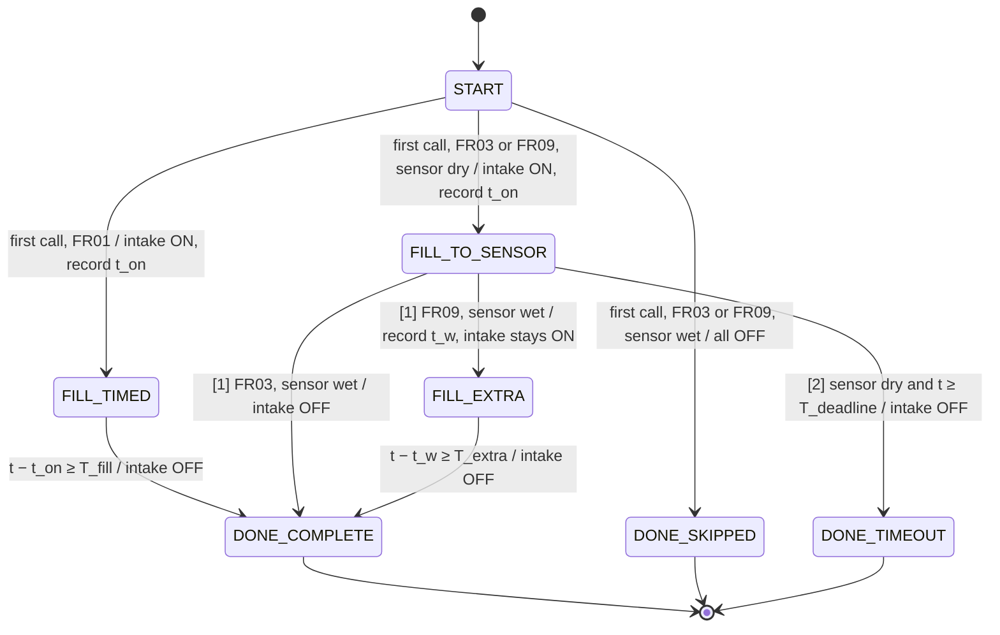
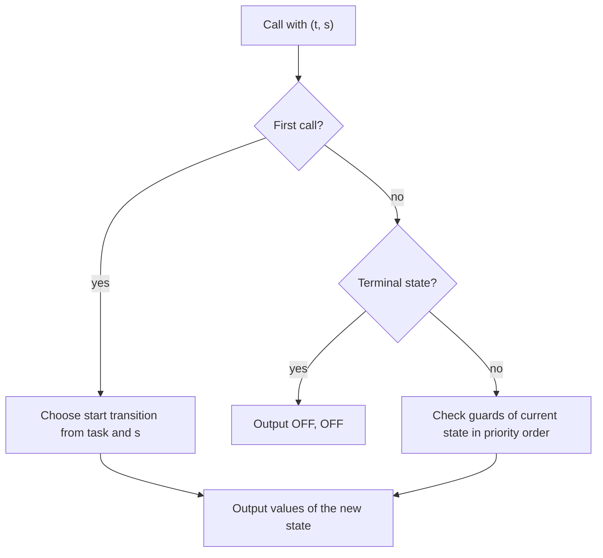

# Controller behaviour specification (WP06)

> **Status: Approved by researcher 2026-11-25 (agent-completed by Claude Code).** Normative, implementation-independent description of what a correct controller does for the selected requirements (FR01, FR03, FR09, FR08; `design/functional_requirements.md`). It states observable behaviour at the controller interface (D29, D35), not how to code it. Numbers are placeholders (D34) and are referred to by their IDs (P…, R…). D36 (fresh controller per run) approved.

**Use of this document (D29).** This is an evaluator-side artifact. It is used to judge controllers, to trace failures to requirement checks and to build the evaluator (WP12). It is **not** given to the clean-room session that generates controllers. Which task descriptions enter the generation prompt is fixed in WP08; by default the prompt does not contain this state machine, the check IDs, the scenarios or the tolerances.

## 1. Interface recap (D29, D35)

- **At run start, once:** task (FR01, FR03 or FR09), its parameter (T_fill or V_target) and the known parameters V_sensor (P05), Q_in (P06), T_deadline (R06).
- **At each call:** input current time t (seconds, supplied by the harness; first call at t = 0) and normalized sensor s (wet = True). Output intake ON/OFF and outtake ON/OFF.
- No status output; the run ends at T_end (R08), decided by the harness.

## 2. Behavioural constraints (all tasks)

| ID | Constraint | Observable as | Source |
|---|---|---|---|
| K1 | Decisions depend only on the start parameters, the supplied time and the sensor inputs received so far | Same inputs give the same outputs in every environment (replay) | D29, D07 |
| K2 | Time is taken only from the supplied t, never from a wall clock | Replay in simulation gives identical outputs | D29 |
| K3 | Each call returns without waiting; no sleeping or blocking | Harness call timing; blocking faults are out of scope (D29) | D29 |
| K4 | The outtake output is OFF at every call | FR08-L1 | D26 |
| K5 | Once the intake has been switched OFF, both outputs stay OFF for the rest of the run | FR08-L3 | WP03 |
| K6 | The intake is switched ON at most once per run (single interval rule) | FR01-L1, FR03-L1, FR09-L1 | WP03 |
| K7 | Only the first wet input counts; later sensor changes do not change behaviour | FR03-L2, FR09-L2, FR08-L3 | This document (latching) |

## 3. States

| State | Outputs (intake, outtake) | Meaning | Terminal |
|---|---|---|---|
| START | — (no call has happened yet) | Request received, first call pending | No |
| FILL_TIMED | ON, OFF | FR01: filling for T_fill | No |
| FILL_TO_SENSOR | ON, OFF | FR03/FR09: filling until the first wet input | No |
| FILL_EXTRA | ON, OFF | FR09: filling for T_extra after the first wet input | No |
| DONE_COMPLETE | OFF, OFF | Task achieved as requested | Yes |
| DONE_SKIPPED | OFF, OFF | FR03/FR09 with sensor wet at the first call: nothing to do or level unknown | Yes |
| DONE_TIMEOUT | OFF, OFF | FR03/FR09 with no wet input by T_deadline | Yes |

Terminal states are not reported (D35); the evaluator infers them from the log (section 6). The three terminal states have identical outputs and differ only in the path that led there.

Timers (values remembered by the controller): t_on (time of the call that switched the intake ON), t_w (time of the first wet input), T_extra = (V_target − V_sensor) / Q_in (FR09).

## 4. State machine

At each call the controller first evaluates the transitions of its current state in the listed priority order, then outputs the values of the state it is in after the transition. A transition therefore takes effect in the same call that satisfies its guard.

[1], [2]: priority within FILL_TO_SENSOR. A wet input at the call where t reaches T_deadline counts as "wet by T_deadline" (FR08-L2), so the sensor guard is checked first.

### 4.1 Order of work within one call

### 4.2 Transition table

| From | Guard (in priority order) | Action | To | Requirement checks |
|---|---|---|---|---|
| START | First call, task FR01 | Intake ON; t_on = t | FILL_TIMED | FR01-L1 |
| START | First call, FR03/FR09, s wet | All OFF | DONE_SKIPPED | FR03-L3, FR09-L3 |
| START | First call, FR03/FR09, s dry | Intake ON; t_on = t | FILL_TO_SENSOR | FR03-L1, FR09-L1 |
| FILL_TIMED | t − t_on ≥ T_fill | Intake OFF | DONE_COMPLETE | FR01-L2 |
| FILL_TO_SENSOR | [1] s wet, FR03 | Intake OFF; t_w = t | DONE_COMPLETE | FR03-L2 |
| FILL_TO_SENSOR | [1] s wet, FR09 | t_w = t; intake stays ON | FILL_EXTRA | FR09-L1 |
| FILL_TO_SENSOR | [2] t ≥ T_deadline | Intake OFF | DONE_TIMEOUT | FR08-L2 |
| FILL_EXTRA | t − t_w ≥ T_extra | Intake OFF | DONE_COMPLETE | FR09-L2 |
| DONE_* | any | Both OFF | same | FR08-L3 |

In FILL_TIMED the sensor is ignored (FR01). In FILL_EXTRA the sensor and T_deadline are ignored: the time after the first wet input is bounded by T_extra, which for valid requests is at most (P04 − P05) / P06 = 26 s.

### 4.3 Expected and accepted timing

The state machine describes the expected behaviour: start at the first call, stop at the first call whose guard holds. The requirements accept small deviations: start by t_start (R02), stop within t_resp (R04) of t_w, durations within ε_t (R03). Because the guards use "≥", a stop happens at most one call period (R01) after the exact time, which is inside ε_t.

## 5. Exceptional situations

| ID | Situation | Required behaviour | Basis |
|---|---|---|---|
| X1 | FR03/FR09 with sensor wet at the first call | No ON at any call; DONE_SKIPPED | FR03-L3, FR09-L3 |
| X2 | Sensor never wet in FR03/FR09 (scenario S4) | Intake OFF at the first call with t ≥ T_deadline; DONE_TIMEOUT | FR08-L2 |
| X3 | Sensor changes back to dry after the first wet input, or flickers | Ignored (K7) | FR08-L3 |
| X4 | Sensor becomes wet during FR01 | Ignored; FR01 is timed only | FR01 |
| X5 | Sensor wet at the first call in FR01 | Fill as requested; the request is assumed valid (V0 + Q_in × T_fill below the safe mark) | FR01, WP03 section 4 |
| X6 | The independent cut-off (D27) switches the pump off | The controller is not told and behaves as before. For valid requests a correct controller never reaches the cut-off; if it fires, FR08-L4 fails | D27 |
| X7 | A call arrives late (irregular timing) | Use the supplied t; the stop happens at that late call. Lateness is an environment property measured by the harness, not a controller fault | K2, WP07 |
| X8 | Rig fault: board reset, serial link lost, firmware error | Outside the controller. The run is marked invalid by the harness, not scored as a controller verdict. Pumps are bounded by the firmware step expiry and cut-off | WP01 section 6.4; WP07, WP09a |
| X9 | A second request during a run (request while busy) | Cannot occur: one request per run, given at the start (D35) | D35, D36 |
| X10 | Power-on or reset of the controller | Each run uses a freshly initialised controller in START with no memory of earlier runs; before the first call the environment holds both pumps OFF | D36 |
| X11 | Invalid request (FR09 target not above V_sensor or above the safe mark; FR01 duration that would overfill) | Behaviour not specified and not tested (WP03 section 7) | WP03 |

X8, X9 and X10 settle the WP00 open items "power-on/reset state" and "requests while busy".

## 6. Observable events and how the evaluator infers the path

All events are read from the harness log of calls (t, s, outputs). The state itself is never logged by the controller.

| Event | Definition in the log | Used to infer |
|---|---|---|
| ON edge | First call with intake ON | t_on; START → FILL_* |
| OFF edge | First call with intake OFF after an ON edge | Arrival in a DONE state |
| First wet input | First call with s wet | t_w |
| No ON in run | No call with intake ON | DONE_SKIPPED (if s wet at the first call) |
| Extra ON edge | A second ON edge | Violation of K6/K5 (FR01-L1, FR03-L1, FR09-L1, FR08-L3) |
| Outtake ON | Any call with outtake ON | Violation of K4 (FR08-L1) |
| Cut-off event | Logged by firmware or simulation adapter | FR08-L4 |

End reason inferred by the evaluator: DONE_SKIPPED when there is no ON edge and s was wet at the first call; DONE_TIMEOUT when the OFF edge is at or after T_deadline with no wet input before it (FR03/FR09); otherwise DONE_COMPLETE if the OFF edge matches the task's guard.

## 7. Expected paths for the WP03 scenarios

Placeholder values; times are for Model 1 and match `design/functional_requirements.md` section 9.

| Scenario | Path | Key times |
|---|---|---|
| S1 (FR01, 10 s / 20 s) | START → FILL_TIMED → DONE_COMPLETE | ON at 0 s; OFF at 10 s / 20 s |
| S2 (FR03, V0 = 5 mL) | START → FILL_TO_SENSOR → DONE_COMPLETE | ON at 0 s; t_w = 19 s; OFF at 19 s |
| S3 (FR03 and FR09, sensor wet) | START → DONE_SKIPPED | No ON |
| S4 (FR03, sensor held dry) | START → FILL_TO_SENSOR → DONE_TIMEOUT | ON at 0 s; OFF at 30 s |
| S5 (FR09, 30/40/45/48 mL) | START → FILL_TO_SENSOR → FILL_EXTRA → DONE_COMPLETE | t_w = 19 s; T_extra = 6/16/21/24 s; OFF at 25/35/40/43 s |

## 8. Fault space seen through this specification

For WP14 root-cause mapping only; not a fault catalogue and not to be placed in prompts (AGENTS.md). Each fault type in D29's remaining fault space corresponds to a deviation from a specific transition:

| Fault type (D29) | Deviation | First failing check |
|---|---|---|
| Wrong actuator | Outtake used instead of or with intake | FR08-L1 |
| Wrong condition | Start transition ignores s (ON in X1); wrong guard sense | FR03-L3 / FR09-L3, FR03-L2 |
| Timing error | Wrong duration in FILL_TIMED or FILL_EXTRA | FR01-L2, FR09-L2 |
| Missing stop | No DONE_TIMEOUT transition; no transition out of FILL_* | FR08-L2, FR08-L4 |
| FR09 calculation error | Wrong T_extra (e.g. from V0 instead of V_sensor, wrong units) | FR09-L2, FR09-P1 |

## 9. Open points for later work packages

- WP07: event ordering between plant update and controller call (affects whether S2 stops at 19.0 or 19.1 s), harness call period R01, logging of each call, how a rig fault (X8) is detected and the run invalidated.
- WP08: which task descriptions and exceptions (X1, X2) are stated in the generation prompt; final values of R02–R06.
- WP09b: the reference controller is judged against this specification.
