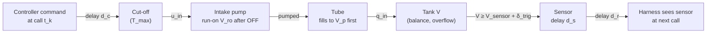

# Mathematical models (WP05, provisional)

> **Status: Provisional, approved by researcher 2026-11-25 (agent-completed by Claude Code); final version after WP04.** Specifies Model 1 and Model 2 before WP04. Every number is a placeholder (D34) referred to by its ID (P01–P19 from `design/physical_system.md` section 12, R01–R11 from `design/functional_requirements.md` section 4); nothing here is a measurement. Which Model 2 effects are finally **included** is decided by the D24 rule after WP04 (section 7); until then every candidate is specified but marked *candidate*. The final WP05 replaces the placeholders and the inclusion column. D39 approved.
>
> Inputs: D24 (fidelity axis), D27 (cut-off), D34 (placeholders), D38 (timing and update order), `design/conceptual_model.md` (states section 7, delay points d1–d6 section 5.3), `design/software_architecture.md` sections 5, 6 and 8.

## 1. In plain terms

Both models answer the same question: "given the pump commands so far, how much water is in the syringe now, and is the sensor wet?"

- **Model 1 (ideal rig).** Water flows in at a fixed rate the instant the intake is ON and stops the instant it is OFF. The sensor is wet exactly when the volume reaches its level. Example: start at 5 mL, intake ON for 10 s at 1 mL/s → 15 mL.
- **Model 2 (rig as it behaves).** The same water balance, plus small real-world effects: the first 2 mL go into the empty tube instead of the syringe, about 0.5 mL still arrives after OFF, the sensor reacts 0.1 s late, and messages take 0.02 s each way. Same example: about 13.5 mL instead of 15 mL.

Model 2 with all its effects set to zero is exactly Model 1 (section 6.3). Whether any effect stays in Model 2 depends on whether WP04 can see it on the rig (D24).

## 2. Units, time and shared conventions

| Quantity | Unit | Representation |
|---|---|---|
| Time t | ms internally, s at the controller interface | Integer milliseconds (D38); the controller receives t_ms / 1000 |
| Volume V, spill, shortfall, tube fill | mL | Real number |
| Flow rate Q | mL/s | Real number; volume per step = Q · Δt_s / 1000 |
| Commands, sensor | — | Boolean (ON = 1, wet = True) |

- **Simulation step** Δt_s = 10 ms (D38 placeholder, kept here). Step n covers the interval [t_n, t_{n+1}) with t_n = n · Δt_s.
- **Call period** Δt_c = R01 = 100 ms, a whole multiple of Δt_s (D38).
- **Zero-order hold.** The pump state used in step n is the effective state at t_n; it does not change inside a step. Since commands change only at call times (multiples of Δt_s), Model 1 is exact for piecewise-constant flow: the step size introduces no volume error (section 6.2). The only discretization effect is that a sensor crossing inside a step is detected at the end of that step, at most Δt_s = 10 ms late, one tenth of a call period.
- **Delays** in Model 2 are whole multiples of Δt_s. With the placeholders (P12 = 2 s, P14 = 0.1 s, P15 = 0.02 s, run-on 0.5 s) this holds exactly. In the final WP05, Δt_s is chosen so that measured delays are representable, or the rounding is recorded next to the parameter.
- **Event time stamps.** A boundary event (overflow, outtake dry) is stamped with the end time t_{n+1} of the step in which it first occurs.

## 3. Parameters

Values are placeholders (D34). "Env" means the shared simulation environment (`design/software_architecture.md` section 6), not the TankSystem.

| Symbol | Meaning | Unit | Used by | Provisional value | Source / replaced by |
|---|---|---|---|---|---|
| C | Syringe capacity (physical overflow level) | mL | Both | 60 | P01 → rig check |
| V_sensor | Sensor level as given to the controller (R07) | mL | Both | 24 | P05 → rig check, WP04 |
| Q_in | Intake flow at the fixed speed (D20) | mL/s | Both | 1.0 | P06 → WP04 |
| Q_out | Outtake flow at the fixed speed | mL/s | Both | 1.0 | P07 → WP04 |
| V_dead | Water the outtake cannot remove | mL | Both | 0 | P09 → rig check |
| V0 | Settled start volume | mL | Both | 5 (default) | P10; per scenario (WP03 section 8) |
| T_max | Cut-off maximum continuous ON time | s | Env, both | 45 | P11 → WP04 (D27) |
| t_p | Intake priming time at Q_in | s | Model 2, candidate | 2 | P12 → WP04 |
| V_p | Intake tube volume to fill before water reaches the tank, V_p = Q_in · t_p | mL | Model 2, candidate | 2 | Derived from P06, P12 |
| f0 | Intake tube fill at the start of a run | mL | Model 2, candidate | 0 | Researcher 2026-11-25: water stays in the tube after OFF, and the planned reset pumps or drains for a fixed time to empty it, so runs start with an empty tube. Reset details and duration in WP08; confirm in WP04 |
| V_ro | Intake run-on volume after each effective OFF | mL | Model 2, candidate | 0.5 | P13 → WP04 |
| δ_trig | Real rising switch point minus V_sensor | mL | Model 2, candidate | TBD, treated as 0 (inactive) | WP04; see section 5.4 |
| d_s | Sensor response delay | s | Model 2, candidate | 0.1 | P14 → WP04 |
| d_c | Command delay host → pump | s | Env, Model 2 candidate | 0.02 | P15 → WP04 |
| d_r | Report delay sensor → host | s | Env, Model 2 candidate | 0.02 | P15 → WP04 |
| Δt_s | Simulation step | ms | Env, both | 10 | D38 |
| Δt_c | Controller call period | ms | Harness | 100 | R01 |
| T_set | Settling time after T_end | s | Env, both | 10 | R09 |

The safe mark P04 is **not** a model parameter: the models do not act on it. It is an evaluator criterion (FR08-P1, FR08-P2).

## 4. Model 1 — ideal rig

### 4.1 States

| State | Unit | Meaning |
|---|---|---|
| V | mL | Water in the syringe, 0 ≤ V ≤ C |
| V_spill | mL | Cumulative water lost by overflow above C |
| V_short | mL | Cumulative outtake volume requested but not available (tank at V_dead) |
| S_true | Boolean | Sensor state |
| overflow, dry | Boolean | Latched flags: overflow has occurred / outtake has run on an empty tank |

Cut-off timers and the delay buffers are environment states (section 4.3), shared by both models.

### 4.2 Inputs

u_in(t_n), u_out(t_n) ∈ {0, 1}: the **effective** pump states for step n, i.e. the controller's command after the command delay and the cut-off (section 4.3). In Model 1 the command delay is zero, so u is the last command, unless the cut-off has forced it OFF.

### 4.3 Shared environment (both models)

Applied by the simulation environment, not the TankSystem (D38, `design/software_architecture.md` section 6):

1. **Command delay.** u_cmd,eff(t) = u_cmd(t − d_c); before the first command both pumps are OFF (D36). Model 1: d_c = 0.
2. **Cut-off (D27, D38).** For each pump, a timer counts continuous effective ON time from the moment the delayed ON command arrives. When it reaches T_max the pump is forced OFF and a `cutoff` event is logged; it stays OFF while the delayed command stays ON; a new OFF → ON edge restarts the timer. Output: u_in, u_out for the TankSystem.
3. **Report delay.** S_reported(t) = S_out(t − d_r), where S_out is the TankSystem's sensor output. Model 1: d_r = 0. Normalization (wet = True) happens here (D29).

### 4.4 Update rule per simulation step n

Given V(t_n) and u_in, u_out:

```
q_in      = u_in  · Q_in  · Δt_s/1000                  (volume delivered to the tank)
q_out_req = u_out · Q_out · Δt_s/1000                  (volume the outtake tries to remove)

V'        = V(t_n) + q_in
if V' > C:   V_spill += V' − C;  V' = C;  overflow = true   (event "overflow" at t_{n+1}, first time only)

available = max(0, V' − V_dead)
q_out     = min(q_out_req, available)
if q_out < q_out_req:  V_short += q_out_req − q_out;  dry = true   (event "outtake_dry" at t_{n+1}, first time only)

V(t_{n+1})      = V' − q_out
S_true(t_{n+1}) = ( V(t_{n+1}) ≥ V_sensor )
```

Order inside a step: intake first, then outtake. The order matters only in a step where both pumps run while the tank is at a boundary; no selected task runs the outtake (FR08-L1), so this is a convention, recorded so that hand checks and code agree.

### 4.5 Sensor rule

S_true(t) = (V(t) ≥ V_sensor): wet at equality. Evaluated at t = 0 on V0 and at the end of every step. No hysteresis (a different switch-off level only matters for draining, deferred by D26). Model 1 sensor output S_out = S_true.

### 4.6 Continuous-time equivalent

Between boundaries, Model 1 is the D24 water balance dV/dt = u_in · Q_in − u_out · Q_out, and for piecewise-constant u the step rule of section 4.4 is its exact solution. The per-step form V(t+1) = V(t) + V_in − V_out of the master context is the same equation (master context; D24: the equation form is not a fidelity difference).

### 4.7 Initialization (t = 0)

- V = V0 from the scenario; valid only if V_dead ≤ V0 ≤ C, otherwise the scenario is rejected before the run.
- V_spill = V_short = 0; overflow = dry = false.
- u_in = u_out = 0 (both pumps OFF before the first call, D36); cut-off timers at 0.
- S_true(0) = (V0 ≥ V_sensor): a tank that starts above the sensor is wet at the first call (scenario S3).
- Delay buffers (Model 2 only, zero length in Model 1) are filled with the initial values: commands OFF, sensor S_true(0).

### 4.8 Boundaries

| Boundary | Model rule | How it stays observable |
|---|---|---|
| Overflow (V would exceed C) | V is held at C; the excess is counted in V_spill; `overflow` event and flag. Not silently clamped: the water is accounted for | `truth.csv` columns `spill_ml`, `overflow`; event in `events.csv`; FR08-P2 fails. Computed only in the models; never caused on the rig (D24) |
| Safe mark P04 | Not a model boundary; the model keeps running | Evaluator compares V_end and V_peak (from `truth.csv`) with P04 (FR08-P1, P2). Rig: settled reading only |
| Empty tank (outtake at V_dead) | Outtake removes only what is available; the rest is counted in V_short; `outtake_dry` event and flag | `truth.csv` column `shortfall_ml`; event. Rig: not characterised, avoid (U30) |
| Source empty | Not modelled: source assumed unlimited (WP02 section 4) | — |
| Cut-off | Environment forces the pump OFF (section 4.3) | `cutoff` event in `events.csv`, rig and models; scored as FR08-L4 failure (D27) |
| End of run | After T_end both pumps are commanded OFF; the TankSystem keeps stepping for T_set so that delayed effects settle | V_end = V at T_end + T_set |

**Mass balance (Model 1).** At every step: V(t) + V_spill(t) − V_short(t) = V0 + Q_in · T_in(t) − Q_out · T_out(t), where T_in, T_out are the cumulative effective ON times in s. This is the conservation check of WP10.

## 5. Model 2 — Model 1 plus candidate rig effects

Model 2 keeps every rule of section 4 (same balance, same Δt_s, same interface, same cut-off, D24) and adds the candidates below. Each is switched off by setting its parameter to zero.

### 5.1 Additional states

| State | Unit | Where (WP07 section 8) | Meaning |
|---|---|---|---|
| f | mL, 0 ≤ f ≤ V_p | Intake `Pump` (Model 2 subclass) | Water held in the intake tube |
| r | mL, 0 ≤ r ≤ V_ro | Intake `Pump` (Model 2 subclass) | Run-on volume still to be delivered |
| u_in,prev | Boolean | Intake `Pump` | Effective state in the previous step (edge detection) |
| sensor history | Boolean sequence of length d_s/Δt_s | `WaterLevelSensor` (Model 2 subclass) | Past S_true values for the response delay |
| command and report buffers | Boolean sequences | Simulation environment | d_c and d_r delays (non-zero only for Model 2) |

### 5.2 Intake: priming and run-on (candidates E1, E2)

Per step n, with u_in the effective intake state after delay and cut-off:

```
if u_in = 1 and u_in,prev = 0:  r = 0                        (pump restarts: pending run-on is superseded)
if u_in = 0 and u_in,prev = 1:  r = V_ro                     (effective OFF edge, including a cut-off)

if u_in = 1:       pumped = Q_in · Δt_s/1000
elif r > 0:        pumped = min(Q_in · Δt_s/1000, r);  r = r − pumped
else:              pumped = 0

to_tube = min(pumped, V_p − f);   f = f + to_tube
q_in    = pumped − to_tube                                   (enters the tank update of section 4.4)
u_in,prev = u_in
```

- **Priming (E1).** Water pumped into an empty tube fills it first; nothing reaches the tank until f = V_p. With f0 = 0 and the pump ON from t_on, water reaches the tank from t_on + t_p.
- **Tube retention (assumption).** f does not decrease while the pump is OFF: a stopped peristaltic pump blocks the tube (WP01 section 7.1; siphoning check U27). Consequently, priming happens only when the tube starts empty, so the start state f0 is an initial condition of every run and must be fixed by the reset procedure (WP08). If the tube stays full between runs, f0 = V_p and E1 has no effect. Researcher statement (2026-11-25): water does stay in the tube after OFF (supports the retention assumption), and the planned reset empties it, so f0 = 0 and priming occurs in every run. Cases with f0 = V_p are kept in section 9 as a check of the rule.
- **Run-on (E2).** After every effective OFF edge (commanded or cut-off), a further V_ro is pumped at rate Q_in, i.e. over V_ro / Q_in = 0.5 s with placeholders. The rate is an assumption: at the syringe resolution only the total V_ro is observable; the time profile matters only for the settling time (T_set must exceed V_ro / Q_in) and for a sensor edge during run-on.
- Run-on passes through the same tube rule, so run-on into an unprimed tube fills the tube first.
- **Outtake.** Unchanged from Model 1 in Model 2. Outtake priming moves water from the tank into the tube as soon as the pump draws, so it does not delay the change of tank volume; outtake run-on is not a candidate because no selected task runs the outtake (D26). If a wrong-actuator fault (D29) makes outtake behaviour matter, the final WP05 revisits this with WP04 data.

### 5.3 Sensor: response delay (candidate E4)

S_true(t_{n+1}) = (V(t_{n+1}) ≥ V_sensor + δ_trig), as section 4.5 with the threshold shifted (section 5.4).

S_out(t) = S_true(t − d_s): a pure delay of the Boolean signal. For t < d_s, S_out(t) = S_true(0) (initial settled state, section 4.7).

The report delay d_r (section 4.3) is applied after it. Because both are pure delays in series, the controller sees S_true(t − d_s − d_r): from host logs only their sum is identifiable (section 8).

### 5.4 Sensor: trigger point (candidate E3)

Model 1 and the controller both use V_sensor, the value the controller is given (R07). E3 is the difference δ_trig between the volume at which the real sensor switches when filling and V_sensor. Whether E3 can exist depends on WP08: if the controller is given the WP04-measured switch volume, then V_sensor is that volume and δ_trig = 0 by construction (excluded, with that reason). If the controller is given a value from the sensor's position or a nominal figure, δ_trig is the measured offset. There is no placeholder for δ_trig; it is treated as 0 (inactive) until then, and only an explicitly labelled illustrative value is used in the check cases.

### 5.5 Communication delay (candidate E5)

d_c and d_r of section 4.3 take P15 each in Model 2 (expected negligible, D24). They are environment parameters supplied by the model, so that the TankSystem stays free of interface timing (D38).

### 5.6 Signal chain (Model 2)



Model 1 is the same chain with V_p = V_ro = δ_trig = d_s = d_c = d_r = 0.

### 5.7 Initialization and boundaries

As section 4.7 and 4.8, plus: f = f0 (scenario/protocol), r = 0, u_in,prev = 0, sensor history filled with S_true(0). Overflow, empty tank, cut-off and end-of-run rules are unchanged. Run-on after T_end and after a cut-off is delivered during T_set and counts in V_end.

**Mass balance (Model 2).** V(t) + f(t) + V_spill(t) − V_short(t) = V0 + f0 + P_in(t) − Q_out · T_out(t), where P_in(t) is the cumulative pumped intake volume (including run-on). Water in the tube is inside the balance but outside the tank.

## 6. The two models are not mathematically equivalent

**Definition.** Two models are equivalent if, for every admissible command sequence and initial condition, they give the same tank volume trajectory and the same sensor signal at the controller interface, possibly after re-choosing the parameters of one of them. Shared assumptions held fixed (D24): same water balance, same Δt_s, same interface, same cut-off, same Q_in and Q_out.

### 6.1 Each candidate effect breaks equivalence

Model 1 can only vary C, V_sensor, Q_in, Q_out, V_dead (and Δt_s, which has no effect: section 6.2). Counterexamples with placeholder values:

| Effect (non-zero) | Input | Model 1 | Model 2 | Why no Model 1 parameter choice reproduces it |
|---|---|---|---|---|
| E1 priming, f0 = 0 | Intake ON 10 s and, in a second run, 20 s, from 5 mL | 10 and 20 mL delivered (ratio 2) | 8 and 18 mL (ratio 2.25) | Model 1 delivered volume is proportional to ON time (Q · T) for any Q; Model 2 is Q · T − V_p, not proportional |
| E2 run-on | Same two runs | 10 and 20 mL | 10.5 and 20.5 mL | Offset + V_ro, again not proportional; also water keeps arriving after OFF, impossible in Model 1 |
| E3 trigger offset (illustrative δ = +0.5 mL) | Fill from 5 mL; controller given V_sensor = 24 | Sensor wet at 24.0 mL | Wet at 24.5 mL | Changing Model 1's V_sensor would also change the value the controller is told (both use R07), so the mismatch between "told" and "real" cannot be represented |
| E4 sensor delay | Fill from 5 mL | Wet at 19.0 s, V = 24.0 | Wet at 19.1 s, V = 24.1 | Model 1 sensor is a memoryless function of V |
| E5 communication delay | FR03 fill from 5 mL (check M2-4) | V_end = 24.0 | V_end = 24.1 | Model 1 has no delay between command and flow |

Combined (section 9): for timed fills, Model 2 delivers Q_in · T + b with b = V_ro − V_p · [f0 = 0] (command delays cancel: ON and OFF are delayed equally). Model 1 delivers Q_in · T. If b ≠ 0, two different durations distinguish the models.

**If effects cancel in one task, they still differ in another.** With V_ro = V_p and f0 = 0, b = 0 and timed fills agree; but in a sensor-stopped fill (FR03) priming only shifts time while run-on adds volume. For a start volume where the Model 1 crossing falls on a call time (as in S2), Model 1 stops exactly at V_sensor, while Model 2 overshoots it by at least V_ro + Q_in · (d_s + d_r + d_c). Every non-zero candidate parameter therefore changes the volume or the sensor signal for at least one input of the selected task set.

### 6.2 What is equivalent and therefore not the fidelity difference

| Variation | Why it is equivalent |
|---|---|
| Rate form vs per-step form of the balance | Identical for constant rates (master context) |
| Simulation step Δt_s (any divisor of Δt_c and of the delays) | Model 1 step rule is exact under zero-order hold; only sensor-crossing detection shifts by < Δt_s |
| Splitting a total sensor-to-host delay between d_s and d_r | Pure delays in series; only the sum reaches the controller |
| Command delay d_c alone, for FR01 end volume | ON and OFF are both delayed by d_c; delivered volume unchanged (check M2-4) |

### 6.3 Nesting

With V_p = 0 (or f0 = V_p), V_ro = 0, δ_trig = 0, d_s = d_c = d_r = 0, every rule of section 5 reduces to section 4, so Model 2 reproduces Model 1 exactly (check M2-11). Model 2 is Model 1 plus effects, as D24 requires, and an excluded effect is simply a zero parameter.

### 6.4 Mathematical difference is not yet a measurable difference

Non-equivalence is a property of the equations. Whether the difference is larger than what the rig can show is the D24 question: e.g. E5 changes the FR03 end volume by 0.1 mL (check M2-4), below the reading uncertainty P03 = ±0.5 mL, so under these placeholders it would not qualify. Nothing here shows that Model 2 detects more controller faults (AGENTS.md); that is WP15's question.

## 7. Included and candidate effects under D24

Inclusion rule (D24): an effect enters Model 2 only if WP04 shows it larger than the syringe reading resolution (volumes) or the log timestamp resolution (times). **Provisional status: no effect is included yet**; all are candidates with placeholder values so that the formulation and checks can be prepared.

| ID | Effect | Status | Shared or Model 2 | Parameter | What WP04 must show to include it | Notes |
|---|---|---|---|---|---|---|
| — | Water balance, calibrated Q_in, Q_out | Included (both models) | Shared | P06, P07 | Calibration only | D24 |
| — | Overflow with spill, empty tank with shortfall, dead volume | Included (both models) | Shared | P01, P09 | — | Boundary rules, section 4.8 |
| — | Cut-off | Included (both environments) | Shared | P11 | — | D27, D38 |
| E1 | Intake tube priming | Candidate | Model 2 | P12 (V_p), f0 | Volume deficit of a timed fill from an empty tube, vs a primed tube, > P03 | Only if the tube can start empty; f0 fixed by WP08 |
| E2 | Intake run-on after OFF | Candidate | Model 2 | P13 | Settled increase after OFF > P03 | Also acts after a cut-off |
| E3 | Sensor trigger point offset | Candidate | Model 2 | δ_trig (TBD) | Measured switch volume differs from the value given to the controller by > P03 | May vanish by construction (section 5.4) |
| E4 | Sensor response delay | Candidate | Model 2 | P14 | Delay > P16, or overshoot volume > P03 | Identifiable only with E5 as a sum from host logs |
| E5 | Command and report delay | Candidate | Model 2 (environment parameters) | P15 | Round-trip > P16 and a visible effect | Expected negligible (D24) |
| X1 | Head-dependent flow (rate varies with level) | Excluded unless data require | — | — | Calibration residuals vs level > P03 | D24 |
| X2 | Random run-to-run variation | Excluded; measured and used for tolerances | — | P08 | — | D24, D27 |
| X3 | Sensor switch-off level / hysteresis | Excluded | — | — | — | Draining tasks deferred (D26) |
| X4 | Tube drain-back or siphoning while OFF | Excluded (retention assumed) | — | — | Observed level change with pumps OFF | U27 |
| X5 | Outtake priming and run-on | Excluded | — | — | Only if a selected fault makes outtake volume matter | No selected task uses the outtake |
| X6 | Motor start-up ramp | Excluded as separate effect | — | — | Not separable from E1 at syringe resolution | Absorbed in the measured offset |
| X7 | Leaks, evaporation | Excluded | — | — | Level change with pumps OFF | WP02 section 8 |

If no candidate qualifies, the finding "Model 1 is sufficient at this rig's resolution" is recorded and the fallback is decided then (D24); no effect is invented.

## 8. Notes for WP04 (identifiability)

- From timed fills alone, settled readings determine Q_in and the combined offset b = V_ro − V_p (empty tube) or b = V_ro (primed tube), not V_p and V_ro separately. Separating them needs runs from both an empty and a primed tube, or a visual observation of first water arrival (U10, U11).
- d_s and d_r appear only as their sum at the host; d_c appears in the time between a command and the resulting change. If one value is needed per delay, the protocol must measure them separately or the model uses the sum.
- E3 requires a slow, settled approach to the sensor level to separate the switch volume from the delays.

## 9. Hand-calculated check cases

Worked out by hand from sections 4 and 5, not from code. Placeholders: Q_in = Q_out = 1.0 mL/s, C = 60, V_sensor = 24, V_dead = 0, T_max = 45 s, Δt_s = 10 ms, Δt_c = 100 ms. Model 2 provisional configuration: V_p = 2 mL, V_ro = 0.5 mL, δ_trig = 0, d_s = 0.1 s, d_c = d_r = 0.02 s; f0 is stated per case. "Correct controller" means the expected behaviour of WP06; "fault" cases are illustrations, not results. Purposes: oracles for the mathematical verification of WP10 and WP11 and cross-checks for WP12; to be rechecked by the researcher. These complement, and agree with, `design/functional_requirements.md` section 9.

### 9.1 Model 1 (TankSystem level, effective commands given directly)

| ID | Set-up | Expected |
|---|---|---|
| M1-1 | V0 = 5, both pumps OFF, 60 s | V = 5.00 throughout; no event; sensor dry |
| M1-2 | V0 = 5, intake ON 0–10 s | V(10 s) = 15.00; stays 15.00 |
| M1-3 | V0 = 5, intake ON continuously | V(18.99 s) = 23.99, dry; V(19.00 s) = 24.00, wet (equality counts as wet) |
| M1-4 | V0 = 55, intake ON 0–10 s (boundary check only; not a valid controller scenario) | V = 60 from 5.00 s; `overflow` event at 5.01 s; V(10 s) = 60.00, V_spill = 5.00; balance 60 + 5 = 55 + 10 |
| M1-5 | V0 = 2, outtake ON 0–5 s | V = 0 at 2.00 s; `outtake_dry` event at 2.01 s; V_short(5 s) = 3.00; balance 0 − 3 = 2 − 5 |
| M1-6 | V0 = 10, both pumps ON 0–10 s | V = 10.00 throughout |
| M1-7 | V0 = 30 | Sensor wet at t = 0 (first call sees wet) |

### 9.2 Model 1 (full loop with harness and cut-off)

| ID | Scenario | Expected |
|---|---|---|
| M1-8 | S1, FR01 10 s / 20 s | V_end = 15.0 / 25.0 (20 s: sensor wet from 19.0 s, ignored by FR01) |
| M1-9 | S2, FR03 | Wet at 19.0 s; call at 19.0 s sees wet and commands OFF; V_end = 24.0 |
| M1-10 | S4, sensor held dry, controller stops at T_deadline = 30 s | OFF at call 30.0 s; V_end = 35.0 |
| M1-11 | S5, FR09 48 mL | t_w = 19.0 s; OFF at 19.0 + 24 = 43.0 s; V_end = 48.0; no cut-off |
| M1-12 | Fault: intake never OFF in S2 | Cut-off at 45.0 s; V_end = 50.0 (exactly the safe mark P04); `cutoff` event |

### 9.3 Model 2, one effect at a time (others zero)

| ID | Effect and set-up | Expected |
|---|---|---|
| M2-1 | E1, V0 = 5, intake ON 0–10 s | f0 = 0: tube full at 2.0 s, V(10 s) = 13.0. f0 = V_p: V = 15.0 (as Model 1) |
| M2-2 | E2, V0 = 5, intake ON 0–10 s | V(10.0 s) = 15.0, rises to 15.5 at 10.5 s, then constant |
| M2-3 | E4, V0 = 5, intake ON continuously | S_true wet at 19.0 s; S_out wet at 19.1 s; V(19.1 s) = 24.1 |
| M2-3b | E3 with illustrative δ_trig = +0.5 (not a placeholder), same set-up | S_out wet at 19.5 s, V = 24.5 |
| M2-4 | E5, d_c = d_r = 0.02 s, full loop | FR01 10 s: flow 0.02–10.02 s, V_end = 15.0 (as Model 1). FR03: crossing at 19.02 s, reported 19.04 s; call 19.0 sees dry, call 19.1 sees wet; flow stops 19.12 s; V_end = 24.1 |

### 9.4 Model 2, provisional configuration, full loop

Step-by-step for S2 with f0 = 0: command ON at 0 → flow from 0.02 s → tube full at 2.02 s → V = 24 at 21.02 s → S_out wet at 21.12 s → reported 21.14 s → call 21.1 s sees dry (true state at 20.98 s: 23.96 mL), call 21.2 s sees wet, commands OFF → flow stops 21.22 s → run-on until 21.72 s. Pumped 21.70 mL, tube 2.0 mL, tank +19.70 mL, V_end = 24.70. Balance: 24.70 + 2.00 = 5 + 0 + 21.70.

| ID | Scenario | f0 = 0 (empty tube) | f0 = V_p (primed tube) | Model 1 |
|---|---|---|---|---|
| M2-5 | S1, FR01 10 s / 20 s | 13.5 / 23.5 (sensor never wet in 20 s run) | 15.5 / 25.5 | 15.0 / 25.0 |
| M2-6 | S2, FR03 | t_w = 21.2 s; V_end = 24.70 | t_w = 19.2 s; V_end = 24.70 | 24.0 |
| M2-7 | S4, stop at T_deadline (call 30.0 s) | 33.5 | 35.5 | 35.0 |
| M2-8 | S5, FR09 48 mL (T_extra = 24 s) | t_w = 21.2 s, controller would stop at 45.2 s, but the cut-off fires at 45.02 s (45 s after flow start at 0.02 s); V = 48.0 + run-on = 48.5; FR08-L4 fails | t_w = 19.2 s; OFF 43.2 s, flow stops 43.22 s; V_end = 48.7; no cut-off | 48.0, no cut-off |
| M2-9 | Fault: intake never OFF in S2 | Cut-off 45.02 s; V_end = 48.5 | Cut-off 45.02 s; V_end = 50.5 > safe mark: FR08-P1 fails | 50.0 (passes exactly at the limit) |
| M2-10 | Fault: one-call intake pulse (0.0–0.1 s) in S3, V0 = 30 | 0.1 + 0.5 mL all into the tube; V_end = 30.0 | V_end = 30.6 | 30.1 |
| M2-11 | Any M1 case with all Model 2 parameters zero | Identical to Model 1 | Identical | — |

What these cases show (with placeholder values only, not findings): the correct controller can trigger the cut-off in Model 2 but not in Model 1 (M2-8, f0 = 0), and the same faulty controller can pass FR08-P1 in Model 1 and fail it in Model 2 (M2-9, f0 = V_p). The models can therefore give different verdicts, which is what D25 compares against the rig. They also show that the start state of the intake tube changes the outcome as much as the effects themselves, so WP08 must fix it. The cut-off margin finding of WP03 (cut-off sized to the safe mark leaves no room for run-on) is confirmed for a primed tube.

## 10. Downstream notes (not executed here)

- **WP04:** measure as section 8; decide f0 (does the intake tube stay full between runs?); report each candidate against P03 / P16.
- **WP08:** fix the reset procedure and therefore f0; decide whether the controller is given the measured switch volume (E3); size the cut-off with margin for run-on (M2-9); FR01-P1 "volume the calibration predicts" should use the same calibration form WP04 fits (Q_in · T, or Q_in · T + b if an offset qualifies).
- **WP10:** implement section 4 and checks M1-1 … M1-12 and the mass balance. To avoid accumulated rounding (D38 note), volumes may be computed from integer-millisecond ON times (V = V0 + Q_in · T_in − …) with spill and shortfall tracked separately; this is mathematically identical to section 4.4.
- **WP11:** implement only the effects WP04 qualifies; checks M2-1 … M2-11 with the final values recomputed by hand.
