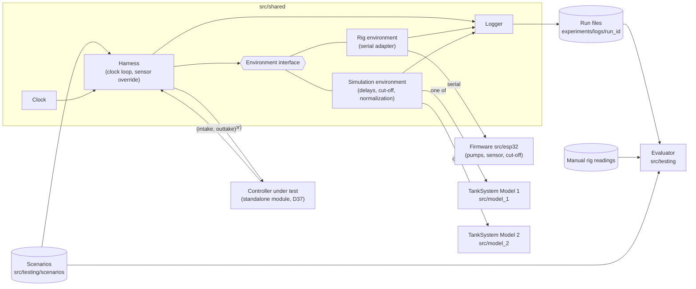
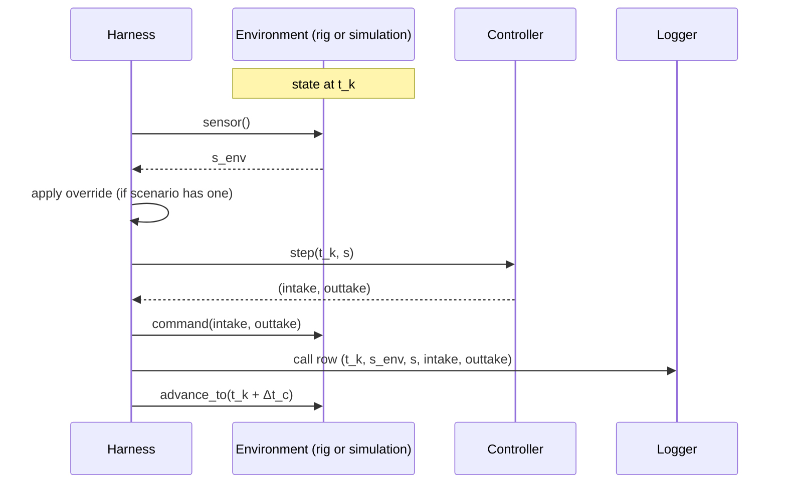
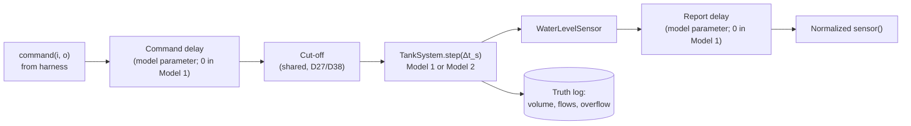
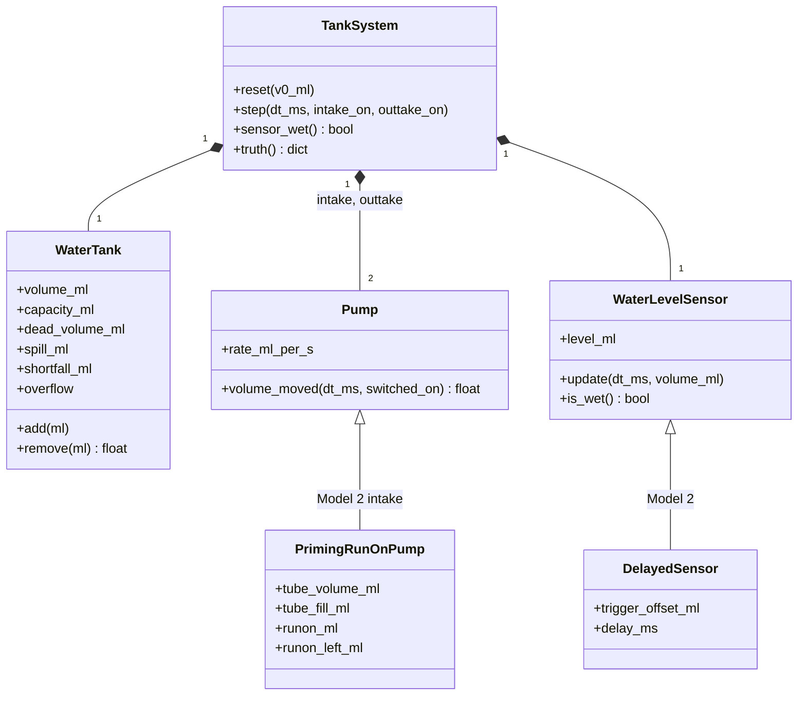

# Software architecture (WP07)

> **Status: Approved by researcher 2026-11-25 (agent-completed by Claude Code).** Minimal architecture for running one controller unchanged against the rig, Model 1 and Model 2, logging every run and judging it independently. Built on WP01–WP03 and WP06. Section 8 was revised on 2026-11-25 after provisional WP05 (`design/mathematical_models.md`); that revision was approved by the researcher 2026-11-25 and is revisited again after final WP05. 2026-11-25: `reset` takes the start volume only, because the intake tube is always empty at the start of a run (D40, approved by researcher). Numbers are placeholders (D34). D37 (controller code interface) and D38 (timing, update order and cut-off semantics) approved.

## 1. Principles

- **Same controller, three environments** (D06, D21). The harness and controller code are identical; only the environment object differs.
- **Information parity** (D07). The controller receives only time and the normalized sensor value; it holds no reference to any environment, model or log object.
- **Separation** (AGENTS.md). Controller, physical simulation and evaluation are separate packages. The evaluator reads logs only and imports neither controllers nor models.
- **Determinism in simulation.** Simulated runs are exactly repeatable (D27: run once).
- **Minimal dependencies.** Python standard library for everything except the rig adapter, which needs a serial library (pyserial; PyCmdMessenger only if WP09a keeps the StepExample protocol). Tests use `unittest`. No GUI (D11). Python version TBD (U25).

## 2. Components and responsibilities

| Component | Package | Responsibility | Must not |
|---|---|---|---|
| Controller | generated, stored under `src/shared/controllers/` | Behaviour of WP06 through the D37 interface | Import repository code, read a wall clock, block, do I/O |
| Harness | `src/shared/` | Creates a fresh controller per run (D36); runs the call loop (section 5); applies the scenario's sensor override (D29); writes the call log | Compute physics or verdicts |
| Environment interface | `src/shared/` | Common interface the harness talks to (section 4) | — |
| Rig environment (adapter) | `src/shared/` (hardware adapter, roadmap WP09a) | Serial communication with the firmware; sensor normalization (P18); fixed speed and direction (P19); paces real time; logs commands, acknowledgements and firmware events | Expose anything but the interface to the harness |
| Firmware | `src/esp32/` (WP09a) | Switches each pump independently; reports the sensor; enforces the cut-off (D27); reports start-up and cut-off events | Contain controller logic (D30) |
| Clock | `src/shared/` | Integer-millisecond time (D38). Simulation clock: advances in fixed steps. Rig clock: reads the computer's monotonic time since run start | Be read by the controller (it receives t from the harness) |
| Simulation environment | `src/shared/` | Shared by both models: command and report delays (parameters from the model; zero in Model 1), the cut-off with rig-identical semantics (D27, D38), sensor normalization, truth log | Contain model-specific physics |
| TankSystem, Model 1 | `src/model_1/` | The simulated tank, two pumps and sensor, built from `WaterTank`, `Pump` and `WaterLevelSensor` (section 8); ideal behaviour | Know about the controller |
| TankSystem, Model 2 | `src/model_2/` | Same parts, with the D24 effects WP04 qualifies added to `Pump` and `WaterLevelSensor` | As above |
| Logger | `src/shared/` | Writes the run files (section 7) | Feed anything back to the controller |
| Scenario definitions | `src/testing/scenarios/` | Data for S1–S5: V0, request, override, T_end (WP03 section 8) | — |
| Evaluator | `src/testing/` | Reads the run files and scenario; computes WP03 checks and the WP06 end-state inference; writes the verdict | Import controllers or model packages |

### 2.1 Component diagram



## 3. Controller code interface (proposed D37)

The clean-room prompt (D29) must state this interface exactly, so it uses only built-in Python types and needs no repository code.

```python
class Controller:
    def __init__(self, task: str, parameter: float,
                 v_sensor_ml: float, q_in_ml_per_s: float, t_deadline_s: float):
        """task is "FR01", "FR03" or "FR09" (wording in the prompt decided in WP08).
        parameter: fill duration in s (FR01), target volume in mL (FR09), ignored (FR03)."""

    def step(self, t_s: float, sensor_wet: bool) -> tuple[bool, bool]:
        """Called every call period. Returns (intake_on, outtake_on)."""
```

Rules: one module, standard library only, no module-level state, no threads, no sleeping, no file or network access. The harness loads the module from a file path and checks the rules statically before a run (imports, names such as `time.time`, `sleep`, `open`, `threading`); a violation is recorded and the controller is not run. Determinism (WP06 K1) is checked by replaying a simulated run and comparing call logs.

The task names given to the controller are neutral labels; the prompt words them (WP08). Check IDs, scenarios and tolerances are not part of the interface.

## 4. Environment interface

```python
class Environment:
    def start(self, scenario) -> None      # set up V0, both pumps OFF, start clock at t = 0
    def now_ms(self) -> int                # current time: simulated, or rig monotonic time since start
    def sensor(self) -> bool               # normalized sensor value (wet = True) as reported now
    def command(self, intake: bool, outtake: bool) -> None
    def advance_to(self, t_ms: int) -> None  # simulation: integrate; rig: wait until then
    def finish(self) -> None               # both pumps OFF; settle period (R09); close
    run_valid: bool                        # False after a rig fault (WP06 X8)
```

Both implementations log their own events (section 7). The interface carries no volume.

## 5. Timing and update order (proposed D38)

**Clock.** Time is kept as integer milliseconds; the controller receives `t_s = t_ms / 1000`. Integer time avoids drift from adding 0.1 s repeatedly.

**Call period** Δt_c = R01 (100 ms placeholder), the same in every environment. **Simulation step** Δt_s = 10 ms (placeholder under D34, fixed with WP05), identical in both models (D24), so delays shorter than Δt_c (e.g. P15 = 20 ms) can be represented. Δt_c is a whole multiple of Δt_s. The water is updated every Δt_s; the controller is called every Δt_c.

**Per call k:**

1. t_k = k × Δt_c (simulation) or the measured time of the call (rig).
2. Environment state is at t_k (the simulated water has been updated up to t_k).
3. s_env = `env.sensor()`.
4. s = override(t_k, s_env) if the scenario defines one (S4 holds it dry), else s_env.
5. (i, o) = `controller.step(t_k / 1000, s)`.
6. `env.command(i, o)`; the command takes effect at t_k plus any command delay of the model (zero in Model 1).
7. Log (t_k, s_env, s, i, o).
8. `env.advance_to(t_{k+1})`.

The loop ends after the call at T_end (R08); the harness then calls `finish()`. In simulation the TankSystem keeps running with pumps OFF for the settle time R09 so that run-on is included in V_end.

**Consequence for the WP06 open point.** With this order, in S2 Model 1 reaches 24.0 mL at t = 19.0 s, the call at 19.0 s sees wet and switches OFF in the same call, so V_end = 24.0 mL (up to floating-point rounding in the volume, which can move the stop to 19.1 s; the WP03 oracles allow one call period).

**Rig pacing.** The rig harness waits until the next nominal tick before each call and logs the actual call time; late calls are logged as events (WP06 X7). The controller receives the actual time.

### 5.1 Sequence of one call



## 6. Simulation environment and safety cut-off



The order mirrors the rig: serial link → firmware (where the cut-off lives) → pump → water → sensor → firmware → serial link (WP02 section 5.3). Delays and the cut-off are shared code; the TankSystem is the only model-specific part.

**Cut-off semantics (identical in firmware and simulation, D38).** For each pump, the cut-off measures continuous ON time from the moment the ON command reaches it. When it reaches the maximum ON time (set per run from the planned start volume, D45, `experiments/experimental_protocol.md` section 8; formerly the single placeholder P11), the pump is forced OFF and a `cutoff` event is logged. The pump stays OFF while the commanded state is still ON; a new ON edge (OFF then ON) starts a new timer. The controller is not informed (WP06 X6).

## 7. Run files (D11)

One directory per run: `experiments/logs/<run_id>/`. Raw files are never edited after the run.

| File | Written by | Content | Environments |
|---|---|---|---|
| `run.json` | Harness | Run ID, date, git commit, controller file and SHA-256, environment and model version, all parameter values with their P/R IDs, scenario ID, Δt_c, Δt_s, end reason (normal, invalid); run purpose, planned and actual start volume, paired rig run ID and per-run T_max with its inputs (D45, D46) | All |
| `calls.csv` | Harness | `t_ms, sensor_env, sensor_given, intake, outtake` (one row per call) | All |
| `events.csv` | Environment | `t_ms, source, event, detail`: command sent/acknowledged, sensor edge reported, cut-off, firmware start-up, late call, run invalidated | All |
| `truth.csv` | Simulation environment | `t_ms, volume_ml, intake_flowing, outtake_flowing, overflow, spill_ml, shortfall_ml` and, in Model 2, `tube_fill_ml` (per simulation step or decimated; WP05 section 4.8); never read by the controller or harness | Models only |
| `manual.csv` | Researcher | `point, time, volume_ml, uncertainty_ml, note` (settled readings before and after; D24, D33) | Rig only |
| `verdict.json` | Evaluator | Each WP03 check: pass/fail/undetermined with evidence; inferred end state (WP06 section 6) | All |

Calibration data from WP04 is stored separately under `experiments/data/` and never mixed with scored runs.

## 8. TankSystem and equation-to-method mapping (aligned with provisional WP05)

`TankSystem` is the simulated counterpart of the physical tank, its two pumps and its sensor. It is the only object the simulation environment talks to, and it is built from one class per physical part, following the master-context mapping (tank → conservation, pump → transferred volume, sensor → threshold). Equations, states, initialization and boundaries are specified in `design/mathematical_models.md` (WP05, provisional; section numbers below refer to it). Revised 2026-11-25 after provisional WP05; approved by researcher 2026-11-25.



In each `TankSystem.step` (one simulation step Δt_s, WP05 sections 4.4 and 5.2): the intake pump reports the volume that reaches the tank and the tank adds it, holding V at C and counting the excess as spill; then the outtake pump reports its volume and the tank removes what is available above the dead volume, counting the rest as shortfall; then the sensor is updated with the new volume. `switched_on` is the effective state after the command delay and the cut-off (environment, WP05 section 4.3). Intake before outtake is a fixed convention.

| Concept (WP05) | Class and method | Model 1 | Model 2 (only effects WP04 qualifies) |
|---|---|---|---|
| Water balance, sections 4.4, 4.6 | `WaterTank.add` / `remove`, driven by `TankSystem.step` | As specified | Same class, unchanged |
| Volume moved by a pump | `Pump.volume_moved` | Q · Δt_s while ON, 0 while OFF | `PrimingRunOnPump` for the intake; outtake stays `Pump` (WP05 section 5.2) |
| E1 tube priming, section 5.2 | `PrimingRunOnPump.volume_moved` | Absent | Pumped water fills the tube (V_p = Q_in · P12) before reaching the tank; tube fill kept while OFF; tube empty at the start of every run (D40) |
| E2 run-on, section 5.2 | `PrimingRunOnPump.volume_moved` | Absent | V_ro (P13) pumped after every effective OFF edge, including a cut-off |
| Sensor rule, sections 4.5, 5.3, 5.4 | `WaterLevelSensor.update` / `is_wet` | V ≥ V_sensor (P05), no delay | `DelayedSensor`: threshold V_sensor + δ_trig (TBD, 0), delay d_s (P14) |
| E5 communication delay, section 5.5 | Simulation environment delays (section 6), not TankSystem | 0 | d_c, d_r (P15) |
| Cut-off, section 4.3 | Simulation environment (section 6) | Same | Same |
| Overflow, section 4.8 | `WaterTank.add`: V held at C, excess added to `spill_ml`, `overflow` flag and event | Same | Same |
| Empty tank, section 4.8 | `WaterTank.remove`: returns only water above `dead_volume_ml` (P09), shortfall added to `shortfall_ml`, `outtake_dry` event | Same | Same |
| Mass balance, sections 4.8, 5.7 | Checked by WP10/WP11 tests from `truth()` | V + spill − shortfall = V0 + in − out | Adds tube fill f on the left (start fill f0 = 0, D40) |

**Initialization** (`reset`, WP05 sections 4.7, 5.7): V = V0, spill and shortfall 0, pumps OFF, sensor state computed from V0 (wet if V0 ≥ threshold), delay buffers filled with the initial values, intake tube empty (Model 2; D40). V0 outside [V_dead, C] is rejected before the run.

**Step size.** Δt_s = 10 ms is kept (WP05 section 2): all placeholder delays are whole multiples of it, and the Model 1 step rule is exact, so the step size is not a fidelity difference. Delays in Model 2 must be whole multiples of Δt_s, or their rounding is recorded.

**How the two models share code.** `src/model_1/` defines `WaterTank`, `Pump`, `WaterLevelSensor` and `TankSystem`. `src/model_2/` reuses `WaterTank` unchanged (the shared water balance, D24) and defines the subclasses `PrimingRunOnPump` and `DelayedSensor` with only the effects WP04 qualifies; Model 2 delay parameters for the environment are supplied with the model. With all Model 2 parameters zero the subclasses behave exactly as the Model 1 classes (WP05 section 6.3), which is itself a test. The difference between the models is therefore visible in those two subclasses and the delay parameters alone.

**Clock.** `Clock` holds integer-millisecond time (D38). The simulation clock is advanced by the simulation environment in steps of Δt_s; the rig clock reads the computer's monotonic time since run start. `Environment.now_ms()` delegates to it; the controller never sees it directly.

## 9. Evaluator boundary

- Input: the run directory, the scenario definition and the parameter set. Output: `verdict.json`.
- Implements the WP03 checks by ID and the WP06 end-state inference; physical checks use `truth.csv` (models) or `manual.csv` (rig) only.
- Runs after the run, never during it, so it cannot influence the controller.
- Built test-first against a stub TankSystem and hand-written logs (D28, WP12), using the WP03 section 9 oracles.

## 10. Directory layout

```
src/
  shared/        harness, environment interface, simulation environment, rig adapter, logger
  shared/controllers/   generated controllers, one file each, unchanged after generation
  esp32/         rig firmware (WP09a), derived from StepExample
  model_1/       TankSystem for Model 1 (WaterTank, Pump, WaterLevelSensor)
  model_2/       TankSystem for Model 2 (reuses WaterTank; extends Pump and WaterLevelSensor)
  testing/       evaluator, scenario definitions, tests (unittest)
experiments/logs/<run_id>/   run files (section 7)
```

## 11. Choices and trade-offs

| Choice | Alternative considered | Reason |
|---|---|---|
| Controller in the same process, loaded from a file | Separate process per controller | Simpler and fast; parity is ensured by passing only built-in values and by the static rule check. A separate process would add isolation but more code |
| Fixed time step | Event-driven simulation | Easy to reason about and to hand-check; matches the scan-cycle controller shape (D29) |
| Integer millisecond clock | Float seconds | Exact times for oracles and replay |
| Post-hoc evaluation from logs | Live checking during runs | Evaluator stays independent and can be re-run on old logs |
| Shared delays and cut-off in the simulation environment | Inside each model | Guarantees the identical cut-off (D27) and keeps the models to the physics |
| Commands sent to the rig only on change | Every call | Less serial traffic; the call log still records every output |

## 12. Requirements on WP09a (rig I/O firmware and adapter)

Independent ON/OFF per pump; sensor reported on change and on request; cut-off with D38 semantics and an event message; start-up message detected by the adapter, which then sets `run_valid = False` (WP06 X8); fixed speed and direction set once (P19), not per command; host timestamps on every send and receive. The protocol (extend StepExample's commands or define new ones) remains open under D16.

Status 2026-11-26 (WP09a, approved 2026-11-26, D49): implemented in `src/esp32/` (firmware, not compiled for the board, not uploaded) and `src/shared/rig_protocol.py`, `rig_environment.py`, `run_rig.py` (host adapter and rig runner). The protocol replaces StepExample's timed `kStep` with a per-run limit command and a compiled-in ceiling (D45); message table in `src/esp32/README.md`.

## 13. Open points

- WP05: section 8 revised after provisional WP05 (2026-11-25); revisit after final WP05 (WP04 values, included effects).
- WP08: prompt wording of the task labels; cut-off margin; final R/P values.
- WP09a: protocol (D16; proposed in D49); how the adapter normalizes the sensor once U14/U17 are known (adapter setting `sensor_wet_level`, from the rig check).
- Run ID scheme and how manual readings are entered (form or hand-edited CSV): decide in WP08.
